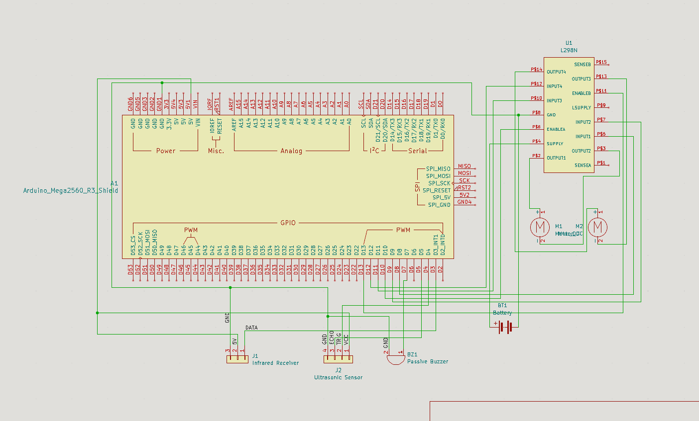
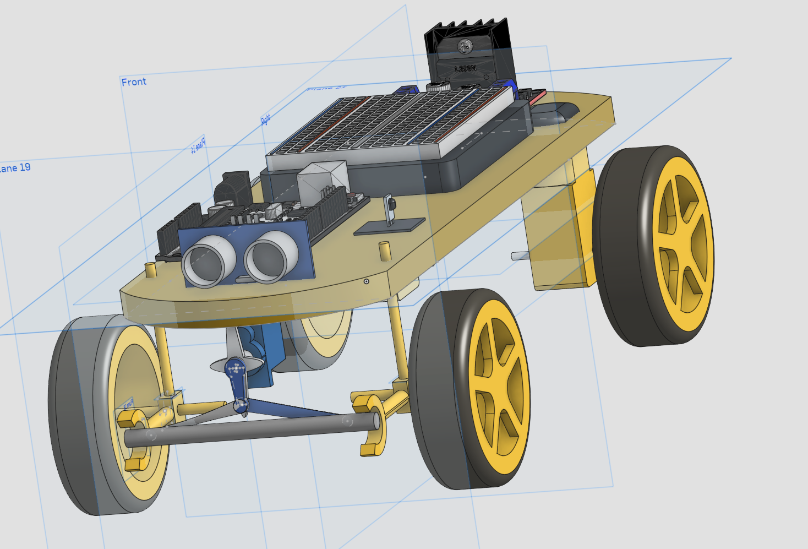
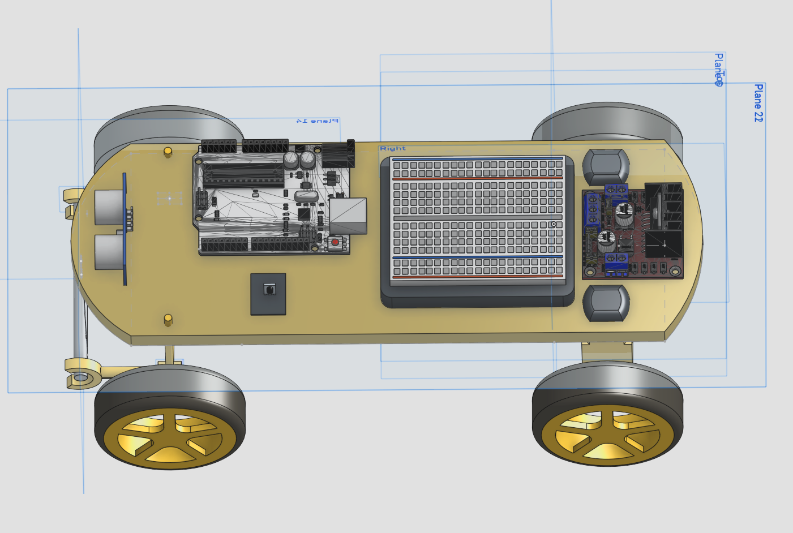

# RC-Car

## Introduction:

This is a RC car I made for the fifth week of the Half Life challenge by Hackclub.
It's controlled by a TV Remote. 

## Build description:

I built the car with only parts and materials I already have at home.
The body of the car will be built with cardboard and wood. The steering system will be built out of Legos. 
You can find the electronics cost in the BOM.csv, but you should already have a lot of the building components and the TV remote. 

## OnShape model link:

https://cad.onshape.com/documents/c4b2f6b1dcfbd659fe523a61/w/d48743c1293dae1c36f29f0a/e/a08f485d04c78471bb069dba

## Firmware:

The firmware is here to control the car.
You can make it go faster/slower and also stop with one button. 
You can control the servo.
There is an emergency stop if the car is less than 20 cm from a wall. 
You will have to adapt the signals to your remote. 

## Schematic picture:

## Pictures of a 3D model of the watch:

## What I learned:

This project taught me how to use infrared signals to control vehicles. 
It also taught me that limitation breeds creativity. It's because I set myself the limit of only using stuff that I already have that I came up with the idea of using the TV remote. 
